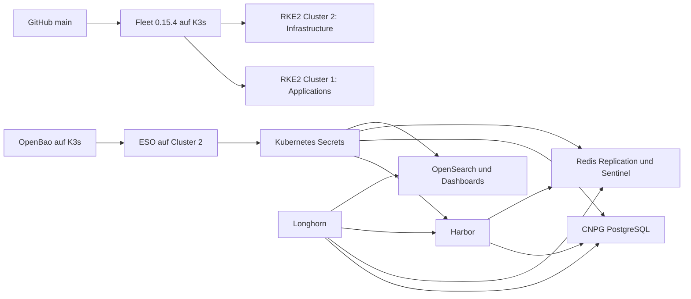

# Zielarchitektur

Status: vorbereiteter vollständiger Lab-Neuaufbau; noch nicht aktiviert.
Entscheidung des Betreibers vom 10.10.2026: frische Daten, Löschung erst nach
separater ausdrücklicher Freigabe. Kein In-place-Adoptionsversuch bestehender Releases.

Cluster 1 bleibt unverändert. Cluster 2 erhält ausschließlich Bundles mit
`overrideTargets.clusterSelector.matchLabels: {environment: lab, role: infrastructure}`.
Der Management-Cluster hat diese Labels nicht. Bundle-Namen beginnen mit `lab-infra-`,
Helm-Releases behalten ihre bisherigen Namen und Namespaces.

Bestehende Namespaces werden nicht als Helm-Ressourcen übernommen. Neue Namespaces
kann Fleet bei Bedarf über `defaultNamespace` anlegen; die Namespace-Objekte selbst
werden nicht in das Store-Bundle aufgenommen. Das vermeidet Eigentumskonflikte
beim additiven ESO-Bootstrap vor der Deinstallation alter Anwendungen.

Die existierende OpenBao-Installation bleibt auf K3s. Cluster 2 verwendet im
OpenBao-Root-Namespace den neuen Auth-Mount `rke2-cluster2` und KV-v2
`secret/platform/*`; keine Wiederverwendung des Mandanten-Namespace `mandant-a`.
Pro Dienst sind ServiceAccount, OpenBao-Rolle, Policy und ClusterSecretStore getrennt.
Stores erlauben nur die jeweiligen Plattform-Namespaces. Die Rolle
`eso-infrastructure` darf ausschließlich den Bootstrap-Testpfad lesen.

## Verantwortung

| Ressource | Verantwortlicher |
| --- | --- |
| Plattform-Helm-Releases, CNPG-Cluster-CR, Registry-PVC | Fleet nach Freigabe |
| SecretStores, ExternalSecrets, Plattform-Auth-ServiceAccounts/RBAC | Fleet |
| Synchronisierte `platform-*` Kubernetes-Secrets | ESO; keine parallele Chart-Verwaltung |
| CNPG-Pods, DB-PVCs, Server-/Replikations-Zertifikate und CA | CNPG Operator |
| Redis-/Sentinel-StatefulSets, Services und PVCs | Redis Operator |
| OpenBao-Policies, Rollen, KV-Bootstrap | expliziter Admin-Bootstrap; künftig Terraform |
| VMs, RKE2-Bootstrap, Rancher-Projekte, Mandanten, Quotas/RBAC | künftig Terraform/Ansible |
| Cilium, Longhorn, cert-manager, Logging, NeuVector, Rancher-Systemressourcen | bestehende Controller; hier nur inventarisiert |

Bei späterer Übernahme der OpenBao-Konfiguration durch Terraform zuerst den Iststand
importieren und den manuellen Bootstrap außer Betrieb nehmen. Dieselbe Ressource darf
nie parallel Terraform und Fleet gehören. Mandanten-Terraform wird hier nicht erstellt.

## Bewusst erhaltene Eigenschaften und Änderungen

Charts bleiben auf den gemessenen Versionen. CNPG: drei Instanzen PostgreSQL 16.3,
je 1Gi; Redis: drei Replikas und drei Sentinel-Prozesse, je Redis 2Gi; Harbor:
zweifache Core/Registry/Portal/Jobservice-Replikation und 10Gi RWX; OpenSearch:
drei Instanzen mit 10Gi, Dashboards eine Instanz. Requests/Limits bleiben erhalten.

Harbor verbindet weiterhin über den durch den Redis-Operator aktualisierten
Master-Service. Ein späterer direkter Sentinel-Umbau ist separat zu testen.
Bestehende Cluster-1-Bundles und aktive GitRepo-Pfade bleiben bytegleich.

Der frische OpenSearch-Aufbau ersetzt das Demo-Sicherheitssetup durch eine eigene
Lab-CA, Node-Zertifikate und eine aus OpenBao geladene Security-Konfiguration.
Dashboards prüft das Backend-Zertifikat. Sein öffentlicher HTTP-Ingress bleibt
zunächst wie inventarisiert; TLS für diesen Ingress ist vor produktiver Nutzung
separat zu planen. Die OpenSearch-Transport-Zertifikatskette und Node-DN werden geprüft;
Hostname-Prüfung bleibt bei gemeinsamem Lab-Node-Zertifikat deaktiviert.

Dies ist ein PoC, keine bereits produktionsreife AFI-Plattform: unter anderem
Storage-Redundanz, Backup/Restore, Zertifikatsrotation, Verfügbarkeit des einzelnen
OpenBao-Servers, Patchstände, Ingress-TLS und Ausfalltests sind eigene Abnahmen.

## Technische Quellen

- [Fleet 0.15.4 FleetYAML](https://github.com/rancher/fleet/blob/v0.15.4/pkg/apis/fleet.cattle.io/v1alpha1/fleetyaml.go)
- [Fleet 0.15.4 BundleSpec und dependsOn](https://github.com/rancher/fleet/blob/v0.15.4/pkg/apis/fleet.cattle.io/v1alpha1/bundle_types.go)
- [OpenBao Kubernetes Authentication](https://openbao.org/docs/auth/kubernetes/)
- [ESO Vault Provider, Kubernetes Auth](https://external-secrets.io/latest/provider/hashicorp-vault/)
- [OpenSearch Security YAML](https://docs.opensearch.org/latest/security/configuration/yaml/)
- [OpenSearch Security 3.9.0.0 Konfigurationsvorlagen](https://github.com/opensearch-project/security/tree/3.9.0.0/config)

Die installierten CRD-Schemas und die heruntergeladenen, exakt gepinnten Charts
haben bei der Validierung Vorrang vor versionsübergreifenden Dokumentationsbeispielen.
